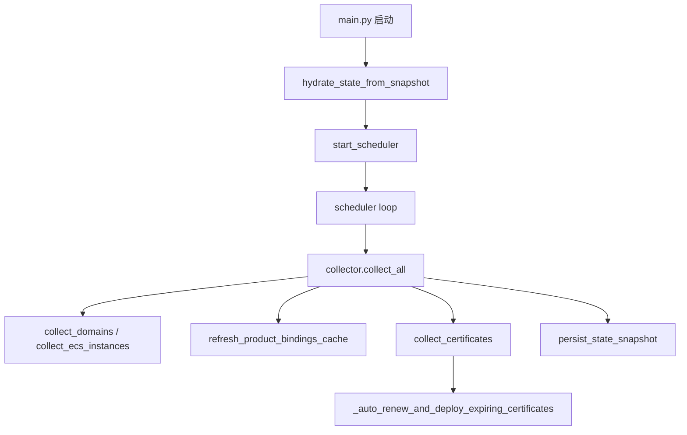
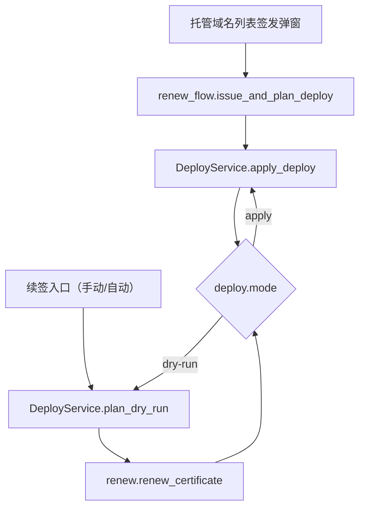

# CRT 运行流程总览

本文只保留运行主流程与关键入口状态，细节见 `flow-services.md` 与 `flow-overview.svg`。
模块职责详见 `services.md` / `providers.md` / `deploys.md`，配置规则详见 `config-rules.md`。

## 1. 调度与采集主流程（简版）

## 2. 签发/续签编排与部署主流程（简版）

## 3. 细节参考

- 采集链路细节：`flow-services.md`
- 总览视角：`flow-overview.svg`
- 部署细节：`deploys.md`

## 4. 当前开关状态

- `refresh_product_bindings_cache()` 已启用，仅刷新 `product_bindings_cache.json`。
- 自动续签编排入口已启用，受 `auto_renew_enabled=true` 与 `auto_renew_days>0` 共同控制。
- 自动续签在阈值内强制执行 ACME 命令，但始终遵守成功冷却期及 `deploy_failed` 待人工处理保护；同轮按实际证书标识去重，部署范围仍为全部云厂商和 Nginx。
- 本轮域名采集失败时，不执行证书采集或自动续签，也不基于历史快照操作；独立采集继续，汇总失败后等待下一轮重试。
- UI 的托管域名列表提供可编辑“签发”弹窗，用于本机 acme.sh 首次接管；证书池仅提供“强制续签 / 部署”。

## 指定运行风险修复

- 运行配置使用模型校验后的类型、默认值和归一化结果；配置文件仍保留用户输入和继承结构。
- `tls_scan_parallel` 是 TLS 探测并发数，必须大于 0；显式探测并发参数也执行相同校验。
- TLS 通配符只覆盖一个标签：`*.xx.hj.com` 覆盖 `a.xx.hj.com`，不覆盖 `xx.hj.com`、`hj.com` 和 `a.b.xx.hj.com`。
- 部署和预演入口只检查证书到期时间，已过期证书在上传之前失败；旧证书仍可被续签器读取。
- 单个账号构造、上传或部署失败记入失败结果，继续其他账号及 Nginx；部分成功仍报告部分失败并保留结果。腾讯证书上下文发现同样按账号隔离。
- 保存配置先等待当前自动采集及其续签、部署完成，再写入并切换配置。等待期间继续使用旧配置；已有 ACME 超时仍有效。停止调度会立即唤醒间隔等待，但不强行取消在途任务。手动操作不由自动调度停止入口管理。
- 损坏或截断的状态 JSON 保存为同目录的 `<文件名>.corrupt-<唯一标识>.bak`，备份成功后原路径恢复为空状态。备份失败则报错且不覆盖原文件；业务数据结构错误仍按原逻辑报错。
